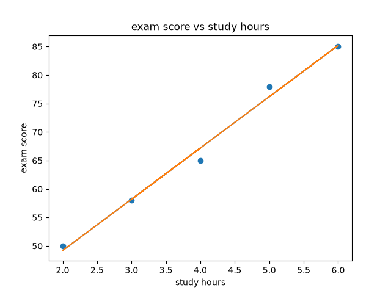

# Student Grade Prediction and Analysis

## Project Overview
This project uses Python to explore the relationship between students' study hours and exam scores. It applies basic statistical analysis, data visualization, and linear regression to predict exam scores.

## Objectives
- Calculate descriptive statistics.
- Explore the correlation between study hours and exam scores.
- Visualize the relationship using a scatter plot.
- Build a linear regression model.
- Predict exam scores based on study hours.
- Evaluate model predictions using MAE and R².

## Technologies Used
- Python
- pandas
- Matplotlib
- scikit-learn

## Dataset
The project uses a small example dataset containing five students, their study hours, and their exam scores.

**Note:** The dataset is illustrative and is not real student data.

## Methods
1. Data preparation using pandas.
2. Descriptive statistical analysis.
3. Correlation analysis.
4. Scatter plot visualization.
5. Linear regression.
6. Model evaluation using Mean Absolute Error (MAE) and R².

## Results
The linear regression model produced the following equation:

`Exam Score = 31.2 + (9 × Study Hours)`

For example, the model predicts an exam score of **67.2** for a student who studies 4 hours.

On the five observations used to fit the model:
- **MAE:** 1.04
- **R²:** 0.98

These are training-set results only. Because the dataset contains just five illustrative observations, they do not demonstrate how accurately the model would predict scores for new students.

## Visualization
The project includes a scatter plot with a regression line:

## How to Run
1. Install Python.
2. Install the required libraries:

   `pip install pandas matplotlib scikit-learn`

3. Run the program:

   `python main.py`

## What I Learned
- Performing descriptive statistical analysis with Python.
- Visualizing data with Matplotlib.
- Measuring correlation.
- Building a basic linear regression model.
- Evaluating predictions using MAE and R².
- Managing and publishing a project with Git and GitHub.

## Future Improvements
- Use a larger, real-world dataset.
- Test the model on data it has not seen during training.
- Add more relevant variables.
- Improve input validation and reporting.
